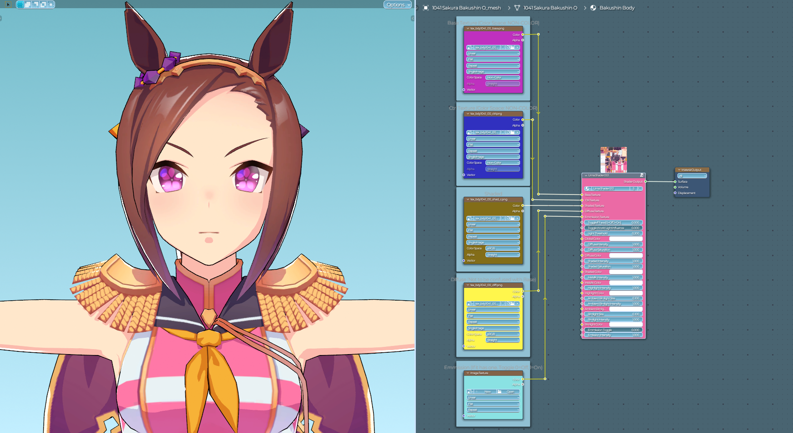
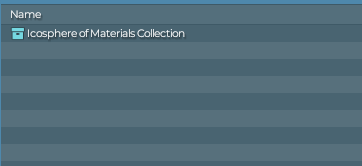
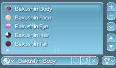
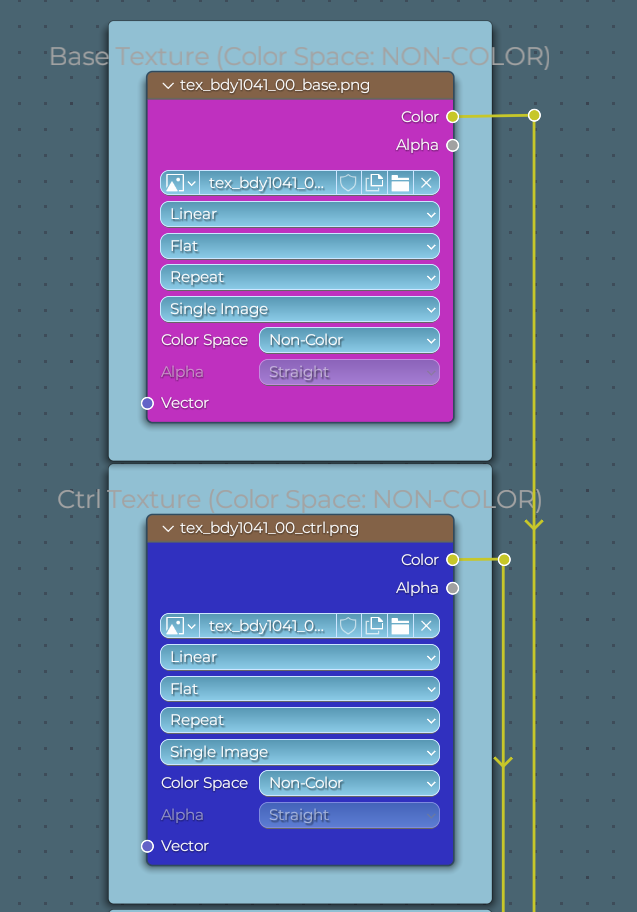
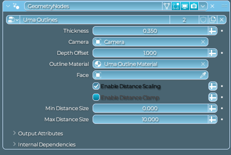

# Umamusume Shaders for Blender (WIP)
A Blender shader for Umamusume: Pretty Derby. Still under development, but I thought it might be better to get it out there now and improve it later.

## How to apply
1. Open a blend file with a model you have extracted, and then **append** the "Icosphere of materials" Collection. It should contain an Icosphere containing the materials and the "sun" object (**DO NOT DELETE**)

2. Apply the material to the model. There are 4 main texture groups using the same shader:
- Body
- Face
- Hair
- Tail 
Meaning **you would have to make 4 copies for each parts**. There is also a separate material specifically for the eyes, with a total of 5 materials at least. 
 
Your material list might be larger at first. Here, I cleaned it up by merging any mesh that uses the same texture into one material, then renaming them. 

3. In the shader editor, **apply the appropriate textures to the appropriate slots** (i.e. Base texture goes to base, etc). Note that the *Color Space* needs to be set to **NON-COLOR** for both Base and Ctrl. 
 
4. For the **outlines**, add a geometry node modifier, and set it to use the uma outline node group, also included in the icosphere. You will need to set the camera option to the current camera you have for it to look good. After that, there will be some black parts in the back of the model. **This is normal.** The outlines is meant to only look good in camera. 

# Known Bugs
- Some model, (i.e.: Meisho Doto) Have issues with the outlines on some parts that's meant to be transparent (Like her frills on her chest.) **I am planning to fix this.**
- The shader currently does not have the face triangles when rotating the sun, as I haven't found the solution to use the texture yet. **I am open to suggestions on how it can be implemented correctly.**  
	+ There *is* a node inside of the main node group that aims to apply the face triangle lighting, but right now It's super clunky, and is at best a hacky way of solving that problem. The node setup was shown to me by @mojuko on discord.

### If you have any questions, or are understandibly confused, feel free to post an issue, and/or contact me via Discord.
[@looperhonstropy](https://discordapp.com/users/294392873074425856) on Discord **(Most active)** 
[@honstropy](https://twitter.com/honstropy) on Twitter

# Special Thanks
- [@AerthasVeras](https://www.youtube.com/@AerthasVeras) for sharing the dot product node setup
- [@coolchouzhao](https://www.youtube.com/@coolchouzhao) for inspiring me to add the world lighting setup.
- @elagrimm and @mojuko for helping with the face shading setup (even though it will be short-lived)

# To-Do List
- Rework Face shading with better method
- Better Documentation
- Promotional Materials
- Fix Outline on transparent parts
